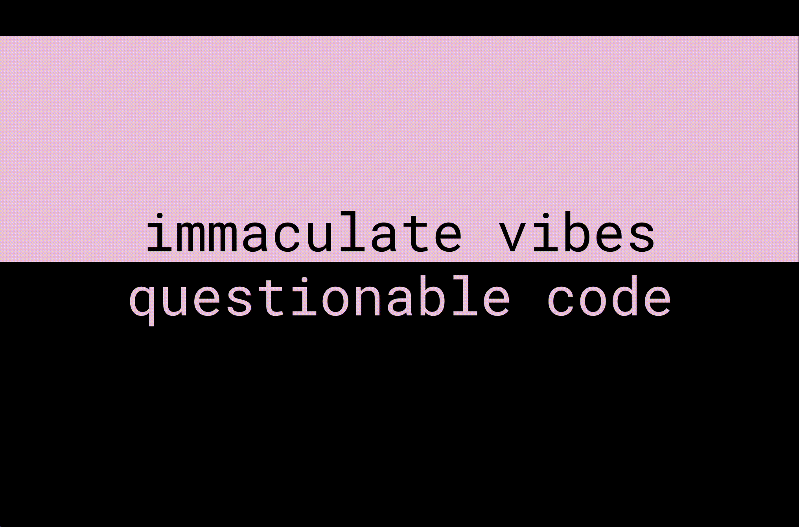

I just wrapped up my first useR conference since Brussels in 2017, and it was just the best. The #rstats community is one of a kind and it was delightful seeing old friends and hearing about all of the amazing things folks are building. 

Yesterday morning Davis Vaughan & I whipped up a last minute shiny app to help us facilitate Q&As after sessions we were chairing and I ended up ditching my original talk today and writing one about that instead 🙃

🧰 tools used: Claude, Positron, RStudio, Google Sheets, Github, Stackoverflow, Slack, Zoom

⏰ timeline: We went from idea to working(ish) prototype in 17 minutes, from working prototype to talk in 24 hours and 14 minutes 

👩‍🏫 takeaways: this was super fun, super fast, and a great way to get a low a stakes app working. I would certianly use a different process if stakes were higher or security was an issue. 

✨ It was just such good vibes, felt a bit like the old unconfs we used to go to that were awesome for getting a big idea quickly implemented. Early iterations were not meant to be perfect but it was a great way to brainstorm & build community

🎥 slides: [https://www.lucymcgowan.com/talk/user2025/](https://www.lucymcgowan.com/talk/user2025/)

sneak peak👇

